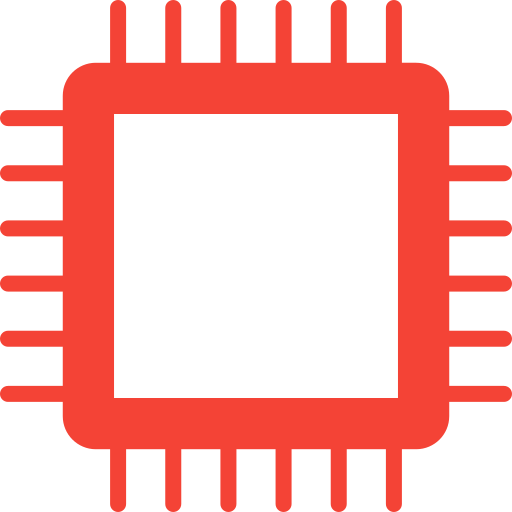

[](https://github.com/sekia-ai/sekia/actions/workflows/ci.yml) [](https://github.com/sekia-ai/sekia/actions/workflows/dependabot/dependabot-updates) [](https://github.com/sekia-ai/sekia/actions/workflows/pages/pages-build-deployment) [](https://github.com/sekia-ai/sekia/actions/workflows/release.yml)

# sekia

A multi-agent event bus for automating workflows across GitHub and Gmail. Built on embedded NATS with JetStream.

**[Documentation](https://sekia.ai/docs/)** &middot; **[Website](https://sekia.ai)**

Four binaries — `sekiad` (daemon), `sekiactl` (CLI), and two agents (`sekia-github`, `sekia-google`) — communicate over NATS. The daemon and CLI also use a Unix socket.

## Architecture

```
┌──────────────────────────────────────────────────────────────────┐
│                              sekiad                              │
│                                                                  │
│  ┌───────────────┐  ┌──────────┐  ┌───────────┐  ┌────────────┐  │
│  │ Embedded NATS │  │ Registry │  │ Workflow  │  │  HTTP API  │  │
│  │ + JetStream   │  │          │  │  Engine   │  │            │  │
│  └───────┬───────┘  └──────────┘  └─────┬─────┘  └──────┬─────┘  │
│          │                              │               │        │
└──────────┼──────────────────────────────┼───────────────┼────────┘
           │ NATS (in-process)            │               │ Unix socket
           │                              │               │
           │                        ┌─────┴──────┐  ┌─────┴──────┐
           │                        │ *.lua      │  │  sekiactl  │
           │                        │ workflows  │  └────────────┘
           │                        └────────────┘
    ┌──────┴──────┐
    │             │
    ▼             ▼
┌────────┐    ┌────────┐
│ sekia- │    │ sekia- │
│ github │    │ google │
└───┬────┘    └───┬────┘
    │             │
    ▼             ▼
  GitHub        Gmail
```

### Startup sequence

1. Start embedded NATS with JetStream
2. Create registry (subscribes to `sekia.registry` and `sekia.heartbeat.>`)
3. Start workflow engine, load `.lua` files, optionally start file watcher
4. Subscribe to config-reload subjects
5. Start HTTP API on Unix socket
6. Block on OS signal or stop channel
7. Shutdown in reverse order (API → workflow engine → registry → NATS)

### NATS subjects

| Subject | Purpose |
|---|---|
| `sekia.registry` | Agent registration announcements |
| `sekia.heartbeat.<name>` | Per-agent heartbeats (30s interval) |
| `sekia.events.<source>` | Event publishing |
| `sekia.commands.<name>` | Command delivery to agents |

## Install

### Homebrew (macOS/Linux)

Each component is a separate formula. Install what you need:

```bash
# Daemon + CLI (required)
brew install sekia-ai/tap/sekia

# Agents (install the ones you need)
brew install sekia-ai/tap/sekia-github
brew install sekia-ai/tap/sekia-google
```

Each formula includes a launchd service. Use `brew services` to manage them:

```bash
# Start the daemon as a background service
brew services start sekia

# Start agents as background services
brew services start sekia-github
brew services start sekia-google

# Check running services
brew services list

# Stop a service
brew services stop sekia-github
```

Logs are written to `$(brew --prefix)/var/log/<formula>.log`.

### From source

```bash
go install github.com/sekia-ai/sekia/cmd/sekiad@latest
go install github.com/sekia-ai/sekia/cmd/sekiactl@latest
go install github.com/sekia-ai/sekia/cmd/sekia-github@latest
go install github.com/sekia-ai/sekia/cmd/sekia-google@latest
```

### Docker

```bash
# Run the full stack (sekiad, sekia-github, sekia-google)
docker compose up

# Or just the daemon
docker compose up sekiad
```

Agent credentials are read from environment variables (`GITHUB_TOKEN`, `GITHUB_WEBHOOK_SECRET`, `GOOGLE_CLIENT_ID`, `GOOGLE_CLIENT_SECRET`). `docker compose` also picks them up from a `.env` file in the project directory:

```bash
# .env
GITHUB_TOKEN=ghp_...
GOOGLE_CLIENT_ID=...
GOOGLE_CLIENT_SECRET=...
```

Individual images can be built with targets:

```bash
docker build --target sekiad -t sekia/sekiad .
docker build --target sekia-github -t sekia/sekia-github .
docker build --target sekia-google -t sekia/sekia-google .
```

## Getting started

### Build

```bash
go build ./cmd/sekiad ./cmd/sekiactl ./cmd/sekia-github ./cmd/sekia-google
```

### Run the daemon

```bash
./sekiad
```

### Query status

```bash
./sekiactl status
./sekiactl agents
./sekiactl workflows
```

`sekiactl` looks for the daemon socket at `$XDG_RUNTIME_DIR/sekia/sekiad.sock`, then `/run/user/<uid>/sekia/sekiad.sock`, then `~/.config/sekia/sekiad.sock`; pass `--socket` to override.

## Configuration

sekia uses TOML config files searched in `/etc/sekia`, `~/.config/sekia`, and `.`. Environment variables with the `SEKIA_` prefix are also supported.

Defaults:

| Key | Default |
|---|---|
| `server.socket` | `$XDG_RUNTIME_DIR/sekia/sekiad.sock`, else `/run/user/<uid>/sekia/sekiad.sock` when that directory exists, else `~/.config/sekia/sekiad.sock` |
| `nats.embedded` | `true` |
| `nats.data_dir` | `~/.local/share/sekia/nats` |
| `workflows.dir` | `~/.config/sekia/workflows` |
| `workflows.hot_reload` | `true` |
| `workflows.handler_timeout` | `30s` |
| `workflows.verify_integrity` | `false` |
| `log.level` | `info` |

Set `nats.host` and `nats.port` to expose NATS over TCP for agents running outside the daemon process, and `nats.token` (env `SEKIA_NATS_TOKEN`) to require a shared token. `security.command_secret` (env `SEKIA_COMMAND_SECRET`) signs workflow commands with HMAC-SHA256; agents verify them with the same secret from their own `[security]` section.

`log.level` (env `SEKIA_LOG_LEVEL`, or the `--log-level` flag) sets the zerolog level for every binary; the default `info` keeps the service logs small. `sekiactl config reload` makes each component re-read the config file it was started with.

See [configs/sekia.toml](configs/sekia.toml) for an example.

### Secrets Encryption

Secret values in config files can be encrypted inline with AWS KMS:

| Format | Backend | Description |
|--------|---------|-------------|
| `KMS[...]` | AWS KMS | Encrypt/decrypt via AWS KMS API |

```bash
# Encrypt with a KMS key
sekiactl secrets kms-encrypt --key-id alias/sekia "ghp_mytoken123"  # → KMS[...]

# Decrypt a value (for debugging)
sekiactl secrets kms-decrypt "KMS[AQIDAHhB...]"
```

```toml
[github]
token = "KMS[AQIDAHhB...]"

[webhook]
secret = "KMS[AQIDAHhC...]"
```

`--key-id` defaults to `secrets.kms_key_id` (env `SEKIA_KMS_KEY_ID`). Every binary resolves `KMS[...]` values at startup and fails fast if one cannot be decrypted. AWS credentials use the standard SDK default chain (env, profile, instance role); set `secrets.aws_region` to override the region. The key ID is embedded in the ciphertext, so decryption needs no key configuration. See [SECURITY.md](SECURITY.md) for details.

## API

The daemon exposes an HTTP API over its Unix socket.

| Endpoint | Description |
|---|---|
| `GET /api/v1/status` | Daemon status, uptime, agent count, workflow count |
| `GET /api/v1/agents` | List registered agents with capabilities and stats |
| `GET /api/v1/workflows` | List loaded workflows with handler patterns and stats |
| `POST /api/v1/workflows/reload` | Reload all workflows from disk |
| `POST /api/v1/config/reload?target=<name\|*>` | Reload configuration on the daemon and all agents, or on a single component (`sekiactl config reload [--target <name>]`) |

## Agent SDK

The `pkg/agent` package provides an SDK for building agents that auto-register and send heartbeats.

```go
package main

import (
	"github.com/sekia-ai/sekia/pkg/agent"
	"github.com/sekia-ai/sekia/pkg/protocol"
)

func main() {
	a, err := agent.New(agent.Config{
		Registration: protocol.Registration{
			Name:         "my-agent",
			Version:      "0.2.3",
			Capabilities: []string{"read", "write"},
			Commands:     []string{"sync"},
		},
		NATSURLs: "nats://127.0.0.1:4222",
	})
	if err != nil {
		panic(err)
	}
	defer a.Close()

	// Use a.Conn() for custom NATS subscriptions
	// Call a.RecordEvent() / a.RecordError() to update counters
}
```

## Workflows

Workflows are Lua scripts that react to events and send commands to agents. Place `.lua` files in the workflow directory (default `~/.config/sekia/workflows/`).

```lua
-- ~/.config/sekia/workflows/github_labeler.lua

sekia.on("sekia.events.github", function(event)
    if event.type ~= "github.issue.opened" then return end

    local title = string.lower(event.payload.title or "")
    local label = "triage"
    if string.find(title, "bug") then label = "bug" end

    sekia.command("github-agent", "add_label", {
        owner  = event.payload.owner,
        repo   = event.payload.repo,
        number = event.payload.number,
        label  = label,
    })

    sekia.log("info", "labeled issue #" .. event.payload.number)
end)
```

### Lua API

| Function | Description |
|---|---|
| `sekia.on(pattern, handler)` | Register handler for NATS subject pattern (`*` and `>` wildcards) |
| `sekia.publish(subject, type, payload)` | Emit a new event |
| `sekia.command(agent, command, payload)` | Send command to an agent |
| `sekia.log(level, message)` | Log a message (`debug`, `info`, `warn`, `error`) |
| `sekia.name` | The workflow's name (derived from filename) |

Workflows run in a sandboxed Lua VM with only `base`, `table`, `string`, and `math` libraries available. Dangerous functions (`os`, `io`, `debug`, `dofile`, `load`) are removed. Each handler invocation is bounded by `workflows.handler_timeout` (default `30s`).

When `hot_reload` is enabled (default), editing or adding `.lua` files automatically reloads the affected workflows.

### Workflow Integrity Verification

When `workflows.verify_integrity` is enabled, the daemon verifies each `.lua` file against a SHA256 manifest (`workflows.sha256`) before loading it. This prevents tampered or unsigned workflows from executing.

```toml
[workflows]
verify_integrity = true
```

Generate the manifest with `sekiactl`:

```bash
sekiactl workflows sign
# Signed 2 workflow(s) in ~/.config/sekia/workflows
# a1b2c3...  github-auto-label.lua
# d4e5f6...  gmail-auto-reply.lua
```

The manifest uses `sha256sum`-compatible format. When hot-reload is enabled, updating the manifest file automatically triggers a full reload of all workflows.

## Agents

Each agent is a standalone binary that connects to the daemon's NATS bus, publishes events from an external service, and executes commands dispatched by Lua workflows.

### Named Instances (Multi-Tenancy)

All agents support a `--name` flag for running multiple instances of the same agent type with different configurations:

```bash
# Two GitHub agents for different accounts
sekia-github --name github-personal   # reads ~/.config/sekia/sekia-github-personal.toml
sekia-github --name github-work       # reads ~/.config/sekia/sekia-github-work.toml
```

When `--name` is set:
- **Config file** becomes `sekia-{agent}-{name}.toml` (unless `--config` overrides)
- **NATS registration** uses the instance name (e.g., `github-work` instead of `github-agent`)
- **Command subject** becomes `sekia.commands.{name}` — target instances from workflows via `sekia.command("github-work", "add_label", payload)`

Without `--name`, behavior is unchanged.

#### Running Named Instances as Background Services

Use `sekiactl service` to manage named instances as background services (launchd on macOS, systemd on Linux):

```bash
# Create a service
sekiactl service create sekia-github --name github-work

# Start/stop/restart
sekiactl service start github-work
sekiactl service stop github-work
sekiactl service restart github-work

# List all managed services
sekiactl service list
# NAME             BINARY         STATUS   PID
# github-work      sekia-github   running  12345
# github-personal  sekia-github   stopped  -

# Remove a service (stops and deletes)
sekiactl service remove github-work
```

Optional flags on `create`:
- `--config /path/to/config.toml` — pass an explicit config file
- `--env KEY=VALUE` — set environment variables (repeatable; stored in plaintext, prefer `KMS[...]` config values)

Logs are written to `~/.config/sekia/logs/{name}.log`. The default `brew services`-managed instance is not affected.

### GitHub Agent

Ingests GitHub events via webhooks and/or REST API polling, and executes GitHub API commands.

**Webhook mode** (default):

```bash
export GITHUB_TOKEN=ghp_...
./sekia-github
```

Point your GitHub repository's webhook settings to `http://<host>:8080/webhook`. Optionally set `GITHUB_WEBHOOK_SECRET` to verify signatures.

**Polling mode** — useful when the agent cannot receive inbound webhooks (e.g., behind a firewall or in local development). Both modes can run simultaneously.

```toml
# sekia-github.toml
[poll]
enabled = true
interval = "30s"
repos = ["myorg/myrepo"]
```

Each tick fetches only the issues, PRs and comments updated since the previous tick, 100 per page, so a steady-state tick costs one API call per repo and label. GitHub rate-limit responses pause polling until the reset time GitHub reports; other errors back off exponentially and never move the watermark. To use polling only (no webhook server), set `webhook.listen = ""`.

**Config**: [configs/sekia-github.toml](configs/sekia-github.toml). Env vars: `GITHUB_TOKEN`, `GITHUB_WEBHOOK_SECRET`, `SEKIA_NATS_URL`.

**Events**:

| GitHub Event | sekia Event Type | Source |
|---|---|---|
| Issue opened/closed/reopened/labeled/assigned | `github.issue.<action>` | Webhook |
| Issue opened/closed | `github.issue.opened`, `github.issue.closed` | Polling |
| Issue updated (any change) | `github.issue.updated` | Polling only |
| PR opened/closed/merged/review_requested | `github.pr.<action>` | Webhook |
| PR opened/closed/merged | `github.pr.opened`, `github.pr.closed`, `github.pr.merged` | Polling |
| PR updated (any change) | `github.pr.updated` | Polling only |
| Issue matched | `github.issue.matched` | Label-filtered mode (`labels` set) |
| PR matched | `github.pr.matched` | PR-match mode (`match_prs = true`) |
| Push | `github.push` | Webhook only |
| Issue comment created | `github.comment.created` | Both |

Polled events include `payload.polled = true` so workflows can distinguish them from webhook events if needed.

**Label-filtered and PR-match modes**: set `labels` to emit `github.issue.matched` for every issue carrying any of the labels, or `match_prs = true` to emit `github.pr.matched` for every PR in `state` (optionally carrying all of `labels`), with full metadata including `author`, `draft`, `labels` and branches. The first tick is a full sweep of every matching item and a sweep repeats every `sweep_interval` (default `1h`, `0` disables), so an event lost while the daemon or an agent was down is replayed; between sweeps an item is emitted again only when GitHub's updated time changes, for example after new commits or a dismissed review. `payload.sweep` tells the two apart. Useful for auto-approval or triage workflows, which must be idempotent.

**Commands**:

| Command | Required Payload | Action |
|---|---|---|
| `add_label` | `owner`, `repo`, `number`, `label` | Add a label to an issue/PR |
| `remove_label` | `owner`, `repo`, `number`, `label` | Remove a label |
| `create_comment` | `owner`, `repo`, `number`, `body` | Post a comment |
| `close_issue` | `owner`, `repo`, `number` | Close an issue |
| `reopen_issue` | `owner`, `repo`, `number` | Reopen an issue |
| `approve_pr` | `owner`, `repo`, `number` | Submit an approving review (optional: `body`) |
| `add_to_project` | `owner`, `repo`, `number`, `project_id` | Add to a Projects v2 board (optional: `fields`) |

**Example workflow**: [configs/workflows/github-auto-label.lua](configs/workflows/github-auto-label.lua)

---

### Google Agent

Bridges Gmail to the NATS event bus via the Gmail REST API with OAuth2 authentication.

```bash
# First time: authorize via browser
sekia-google auth --config configs/sekia-google.toml

# Run the agent
./sekia-google
```

**Setup**: Create OAuth credentials at [console.cloud.google.com/apis/credentials](https://console.cloud.google.com/apis/credentials) with application type "Desktop app". Run `sekia-google auth` to authorize via browser. On a headless or remote machine, set `google.auth_port` and forward that port over SSH so the browser redirect reaches the agent.

**Config**: [configs/sekia-google.toml](configs/sekia-google.toml). Env vars: `GOOGLE_CLIENT_ID`, `GOOGLE_CLIENT_SECRET`, `GOOGLE_TOKEN_PATH`, `SEKIA_NATS_URL`.

| Setting | Description |
|---|---|
| `gmail.enabled` | Must be `true` |
| `gmail.poll_interval` | How often to poll Gmail for new messages |
| `gmail.user_id` | Mailbox to watch (`me` for the authorized account) |
| `gmail.query` | Optional Gmail search query to filter polled messages |
| `gmail.max_messages` | Maximum messages fetched per poll |

`gmail.poll_interval`, `gmail.query`, `gmail.max_messages` and `security.command_secret` can be changed at runtime with `sekiactl config reload`; OAuth2 credentials require a restart.

**Events**:

| Trigger | sekia Event Type | Payload Fields |
|---|---|---|
| New message | `gmail.message.received` | `id`, `thread_id`, `message_id`, `from`, `to`, `subject`, `body`, `date`, `labels` |

**Commands**:

| Command | Required Payload | Action |
|---|---|---|
| `send_email` | `to`, `subject`, `body` | Send a new email |
| `reply_email` | `thread_id`, `in_reply_to`, `to`, `subject`, `body` | Reply to an email |
| `add_label` | `message_id`, `label` | Add a label to a message |
| `remove_label` | `message_id`, `label` | Remove a label from a message |
| `archive` | `message_id` | Archive a message (remove INBOX label) |
| `trash` | `message_id` | Move a message to trash |
| `untrash` | `message_id` | Move a trashed message back to inbox |
| `delete` | `message_id` | Permanently delete a message |

**Example workflow**: [configs/workflows/gmail-auto-reply.lua](configs/workflows/gmail-auto-reply.lua)

---

## Cross-Agent Workflows

The real power of sekia is connecting agents together. Here's a workflow that emails the on-call engineer when a GitHub issue is labeled `urgent`, then acknowledges on the issue:

```lua
-- ~/.config/sekia/workflows/urgent-issue-email.lua

sekia.on("sekia.events.github", function(event)
    if event.type ~= "github.issue.labeled" then return end
    if event.payload.label ~= "urgent" then return end

    local title = event.payload.title
    local url   = event.payload.url
    local repo  = event.payload.repo

    -- Email the on-call engineer
    sekia.command("google-agent", "send_email", {
        to      = "oncall@example.com",
        subject = "[" .. repo .. "] urgent: " .. title,
        body    = "GitHub issue: " .. url,
    })

    -- Leave a note on the issue
    sekia.command("github-agent", "create_comment", {
        owner  = event.payload.owner,
        repo   = repo,
        number = event.payload.number,
        body   = "On-call has been notified by email.",
    })
end)
```

## Upgrading from 0.2.x

0.3.0 trims sekia to the GitHub and Google (Gmail) agents. It is a breaking release:

- **Removed binaries**: `sekia-slack`, `sekia-linear` and `sekia-mcp`. Uninstall them with `brew uninstall sekia-slack sekia-linear sekia-mcp`.
- **Removed config sections**: `[ai]`, `[sentinel]`, `[skills]`, `[conversation]` and `[web]` in `sekia.toml`, `[calendar]` in `sekia-google.toml`, and the `server.listen` key. They are ignored and can be deleted.
- **Removed Lua functions**: `sekia.ai`, `sekia.ai_json`, `sekia.skill`, `sekia.conversation` and `sekia.schedule`. Scheduled workflows are gone entirely; workflows that call these functions must be rewritten.
- **Removed secrets backends**: age (`ENC[...]`) and AWS Secrets Manager (`ASM[...]`), along with `sekiactl secrets keygen|encrypt|decrypt|asm-get`, `SEKIA_AGE_KEY`, `SEKIA_AGE_KEY_FILE` and `secrets.identity`. `ENC[...]` and `ASM[...]` values are no longer recognized and will be used as literal strings; re-encrypt them with `sekiactl secrets kms-encrypt` (or replace them with plaintext) before upgrading. Only `KMS[...]` remains.
- **Removed Google Calendar support**: the `google.calendar.event.*` events and the `create_event`, `update_event` and `delete_event` commands are gone. `sekia-google` is Gmail only and requires `gmail.enabled = true`.
- **Files you can delete**: `~/.config/sekia/persona.md`, `~/.config/sekia/sentinel.md`, `~/.config/sekia/age.key` and the `~/.config/sekia/skills/` directory are no longer read.
- **GitHub polling changed**: every tick now fetches only items updated since the previous tick, 100 per page. `poll.per_tick` is ignored and can be deleted. Label-filtered and PR-match modes sweep every matching item at startup and every `poll.sweep_interval` (default `1h`); matched events carry `payload.sweep`. Workflows acting on matched events must be idempotent.
- **Quieter logs**: every binary now logs at `info` by default. 0.2.x logged at debug level; set `[log] level = "debug"` or `SEKIA_LOG_LEVEL=debug` to get that back.
- **Config reload** re-reads the file the component started with, honoring `--config` and `--name`. Previously named instances reloaded the default file.
- **sekiactl socket discovery**: without `XDG_RUNTIME_DIR`, `sekiactl` now also looks in `/run/user/<uid>/sekia/`, so it finds a daemon started by systemd from an SSH session.

## Testing

```bash
go test ./...
```

Each agent has end-to-end integration tests that start the full daemon with embedded NATS, connect the agent in-process, and verify the complete event-to-command flow through Lua workflows.

## License

Apache 2.0
